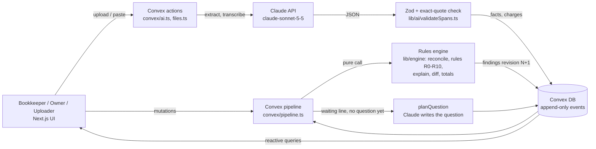

# CargoOS

**Checked before you pay.**

CargoOS checks a freight invoice against what was actually agreed (the quote, the email that amended it, the WhatsApp chat) before the bookkeeper pays it. It sorts every invoice line into **To dispute**, **Waiting on answers** or **Cleared**, asks the owner when evidence is missing, recomputes when the answer comes in, and drafts a dispute that only the owner can approve. Nothing is ever sent or paid automatically.

Built at **Cal Hacks 13.0** (San Francisco, Oct 24–25, 2026).

**Live demo:** https://cargo-os-fawn.vercel.app

> **What the live site shows today:** the deployed page runs in **Replay** mode. It plays a recorded run of Scenario A through the real UI and is labeled "Replay" on screen. The backend described below (Convex pipeline, rules engine, Claude extraction and questions, approvals, learned rules) is merged on `main` and covered by tests, and runs locally with `npm run dev`. See [Real vs simulated](#real-vs-simulated).

---

## The problem

An AP clerk at a small-to-mid US importer gets a $7,500 forwarder invoice. The quote said $6,500. The real agreement is scattered across a quote PDF, an email that changed the ocean rate, and a WhatsApp thread with the forwarder. Some of the extra $1,000 is fair (the quote's fine print allows it), some is an overcharge, and some depends on what someone said in a chat the clerk never saw.

Freight audit tools such as InvoRec, Linehaul and AuditFreight check an invoice against **one clean contract or rate card**. Our users don't have one. CargoOS rebuilds the agreement from the negotiation trail, asks when something is missing, and changes its verdict, with a full audit trail, when the answer arrives.

## What it does

The demo case (Scenario A, fully synthetic):

1. **Reads every document** (quote, email, chat, invoice) and rebuilds what was agreed. Every fact quotes its source word for word.
2. **Sorts the 8 invoice lines.**
   - Line 1, ocean freight: **To dispute, +$300**. The email cut the rate to $4,500 if booked by Sep 10, and the booking was Sep 8.
   - Line 2, the $400 peak-season surcharge: **Cleared**, because the quote's terms allow it.
   - Lines 4 and 6: **Waiting**, because nothing agrees to them.
3. **Asks one question.** CargoOS decides that one question to the owner can settle both waiting lines, and writes it with citations.
4. **Recomputes when the owner answers.** The owner types: *"approved the $200 congestion fee on WhatsApp, nobody agreed to $400 rush handling"*. Line 4 moves to Cleared, line 6 to To dispute, and the amount at stake goes from **$300 to $700**. A "what changed" panel cites the reply for each change.
5. **Approval with separation of duties.** The bookkeeper requests approval of a $700 dispute. Only the owner can accept or reject it (with a reason), and never the person who requested it. A blocked attempt is logged. The dispute message is drafted, never sent.
6. **Remembers decisions.** Marking a line **Not an issue** saves a rule for that forwarder and charge type. The next invoice from the same forwarder clears that charge automatically ("You accepted this charge from Pacific Crest Logistics on Oct 24"), with an undo. Written evidence always wins over a remembered rule.

Every question, reply, extracted fact, verdict change, button click and approval is an **append-only event** in the case history.

## How it works

The core design rule: **Claude reads and writes words, and code decides every number and status.**



| Step | What happens | Who decides |
|---|---|---|
| Extract | A document becomes facts (agreed rates, surcharge clauses, approvals...) and invoice lines, each with a source quote | Claude extracts; code drops any fact whose quote isn't an exact substring of the document |
| Reconcile | Each invoice line runs through rules R0 to R10 and gets a status, an expected amount and a "why" line | Code only (`lib/engine/`, pure functions, no network or clock) |
| Ask | If a line is waiting and no question covers it, one question goes to the owner | Code picks the lines and the recipient; Claude decides whether a question can help and writes it |
| Interpret | The owner's reply becomes approval / rejection facts (yes, partial, no or ambiguous, with one follow-up at most) | Claude reads; code applies |
| Recompute | A new findings revision is stored, the diff goes into the history, and the UI updates live | Code |
| Draft | After the owner accepts, Claude words the dispute message | Claude writes the words; code inserts every number |

**The rules** (`lib/engine/rules.ts`, evaluated in this order, first match wins):

| Rule | Meaning |
|---|---|
| R3 | Billed in a non-USD currency with no agreed exchange rate → waiting |
| R1 | Same charge already billed on an earlier line → dispute |
| R0 / R2 | Latest applicable agreed rate: matches → cleared; billed over it → dispute |
| R7 | Two sources disagree at the same moment → waiting |
| R8 / R9 | The owner approved it → cleared (or over the approved amount → dispute); rejected → dispute |
| R4 | A quote clause permits the surcharge → cleared |
| R5 | The quote excludes it but says it is billable → cleared, outside quote scope |
| R10 | A learned rule from an earlier "Not an issue" for this forwarder → cleared |
| R6 | Nothing agrees to it → waiting |

The full specification, including every edge case the engine settles, is in [`SPEC.md`](SPEC.md) §6.

## Tech stack

| Layer | Choice |
|---|---|
| UI | Next.js 16 (App Router), React 19, TypeScript, Tailwind CSS 4, shadcn/ui |
| Backend + database | Convex: tables, file storage, reactive queries, mutations, actions |
| AI | Claude API via the Anthropic TypeScript SDK, model `claude-sonnet-5-5` (set in `lib/ai/config.ts`) |
| Document reading | `unpdf` (PDF text, server-side), `jimp` (image resize before Claude transcribes screenshots) |
| Validation | Zod for every LLM output and every fixture |
| Tests | Vitest (unit, component, Convex functions via `convex-test`), Playwright (end-to-end) |
| CI / deploy | GitHub Actions (typecheck, lint, tests, build, engine eval), Vercel |

## Repository layout

```
app/                 Next.js pages
components/          UI (case screen, documents, history, inboxes)
convex/              schema, pipeline, AI actions, uploads, drafts (approval), learned rules, seed
lib/engine/          rules engine: money, rules, reconcile, explain, diff, totals (pure)
lib/ai/              Claude client, extraction, quote validator, planQuestion, interpretReply, draftDispute, prompts
lib/types.ts         shared types (the contract between all four workstreams)
lib/schemas.ts       Zod mirrors of the types
fixtures/            Scenario A + 10 variations with answer keys, live demo files
scripts/             eval harness, recorder for Claude test responses
tests/               unit + component tests, recorded Claude responses, e2e
docs/                design docs and demo script
SPEC.md / HACK.md    build spec and plan;  CLAUDE.md: rules every coding agent follows
```

## Getting started

### Requirements

- **Node.js 24** and npm (CI runs on Node 24)
- A **Convex** account (free tier is enough), for the backend
- An **Anthropic API key**, for extraction, questions and drafts

### Install

```bash
git clone https://github.com/CustomTwoBot/CargoOS.git
cd CargoOS
npm install
```

### Run the UI only (no accounts needed)

```bash
npm run dev:next
```

Open http://localhost:3000. This is the same Replay mode as the live demo: no Convex, no Claude.

### Run the full stack

```bash
npx convex dev                                    # first run: log in and create a project; writes .env.local
npx convex env set ANTHROPIC_API_KEY sk-ant-...   # stored in Convex only, never in the repo
npx convex run seed:resetDemo                     # load the Scenario A demo case (the three people are in lib/people.ts)
npm run dev                                       # Next.js + Convex dev servers together
```

### Environment variables

| Variable | Where it lives | Set by | Used for |
|---|---|---|---|
| `ANTHROPIC_API_KEY` | Convex environment (`npx convex env set`) | you | Every Claude call. Never put it in `.env.local`, code or commits |
| `CONVEX_DEPLOYMENT` | `.env.local` | `npx convex dev` | Which Convex deployment the CLI talks to |
| `NEXT_PUBLIC_CONVEX_URL` | `.env.local`, and the Vercel project settings for deploys | `npx convex dev` | The Convex URL the Next.js app connects to |
| `E2E_BASE_URL` | your shell (optional) | you | Run Playwright against a deployed URL instead of starting a local server |

### Scripts

| Command | What it does |
|---|---|
| `npm run dev` | Next.js and Convex dev servers together |
| `npm run dev:next` | Next.js only (Replay mode) |
| `npm run test` | Unit, component and Convex tests (Vitest). No API calls: Claude is tested with recorded responses |
| `npm run eval` | Engine-only eval on every fixture (runs in CI) |
| `npm run eval:full` | Eval with real Claude extraction (manual; uses API credits) |
| `npm run test:e2e` | Playwright end-to-end journey |
| `npm run typecheck` / `npm run lint` | Type and lint checks |
| `npx convex run seed:resetDemo` | Restore the Scenario A demo case to its starting state |

## Testing and evaluation

- Every engine rule, the pipeline, the approval gate and learned rules have tests. CI runs typecheck, lint, all tests, a production build and the engine eval on every push.
- Claude calls are tested against **recorded responses** in `tests/recordings/`, so CI never calls the API.
- **Engine-only eval** (`npm run eval`): Scenario A plus 10 variations (amended rate booked late, duplicate line, foreign currency, conflicting sources, excluded duties, the owner saying yes / no / something vague, and more), each with an answer key we wrote:

| Metric | Result |
|---|---|
| Finding status accuracy | 127 / 127 |
| False positives on legitimate lines | 0 / 110 |
| Question decision (ask vs don't ask) | 11 / 11 |
| Revision correctness after replies | 6 / 6 |
| Source validity (quotes found in their documents) | 309 / 309 |
| Case totals | 57 / 57 |

These numbers measure the rules engine on extracted facts from our **synthetic** set. They are not a measure of real-world accuracy.

## Real vs simulated

- All shipments, companies, people and documents are **synthetic**, with answer keys we wrote. The live sample files were written by us to match Scenario A.
- The three people (Maya the bookkeeper, Sam the owner, Leo the uploader) are **seeded**. Each screen is set to one of them, and there is no real login, so access limits are screen settings, not security.
- The deployed site currently runs the **recorded Replay**, labeled on screen. The live backend runs locally (see above).
- Learned rules are **stored rules, not machine learning**: same input, same output.
- Photo uploads are transcribed by Claude, and quotes are checked against that transcription, not against the image.
- No real customer validation beyond the conversations we actually had.

**Known limits:** USD is the only base currency (a non-USD line always waits for review); one shipment per case; documents are read as text (no layout analysis); nothing is sent to the forwarder or paid.

## Team

| Person | Contributions |
|---|---|
| **Dev Patel** | Case engine (`lib/engine/`): money and date helpers, rules R0–R10, `reconcile`, "why" line templates, revision diff, case totals. The Convex pipeline (`convex/pipeline.ts`): recompute on every change, verdicts, line editor, recompute across a forwarder's open cases for learned rules. Aligned `planQuestion` with the people model. Recorded the engine's decisions in SPEC. |
| **Pranav Krishna** | Plan, spec and agent rules (`SPEC.md`, `HACK.md`, `CLAUDE.md`). Scaffold, shared types and schemas, CI and Vercel deploy. Claude agent: client, quote validator, questions, reply reading, dispute drafting. Extraction from PDF, email, text and screenshots. Uploads, case queries, dispute approval with the requester check, learned-rule storage, seed, fixtures, variations and the eval harness. |
| **Dzhamal Chapanov** | Frontend (`app/`, `components/`): the case screen, issue views, evidence panel with highlighted source quotes, documents and history views, inboxes, sidebar, per-device people and settings, the Replay demo, and the design docs. |
| **Arpan Savani** | Early planning. Left on Oct 24; his workstream moved to Pranav. |

## AI disclosure

- **In the product:** Claude (`claude-sonnet-5-5`, Anthropic API) extracts facts with source quotes, transcribes screenshots, decides whether and what to ask, reads replies, and words the dispute message. It never computes an amount or decides a status.
- **Building it:** we used **Claude Code** as our coding agent. Every agent followed the shared rules in [`CLAUDE.md`](CLAUDE.md) and the build spec in [`SPEC.md`](SPEC.md). Each person reviewed, tested and merged their own work through pull requests with CI.
